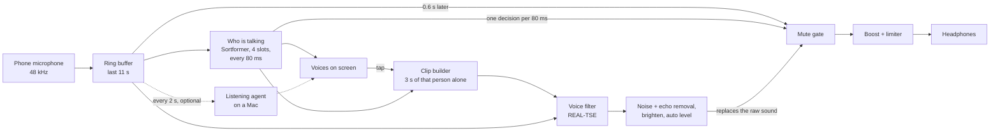

# Tether

**Pick one voice in a noisy room and hear only that person.**

Put your iPhone on the table, put your headphones in, and Tether shows the people talking around you. Tap one and that voice is what reaches your ears; everyone else, and the room, is turned down. It was built for people who get overloaded by noisy rooms and for anyone who needs to follow one speaker: a student and a teacher, a customer and a barista, one friend at a loud table.

All of the listening and filtering runs on the phone. Built at a hackathon in November 2026; tested on iPhone 13 Pro and iPhone 14 Pro Max with AirPods.

## What it does

- **Finds the voices.** Each person who talks gets a spot on screen after a couple of seconds, with no setup and no voice sample.
- **Isolates the one you tap.** The headphones stay silent until you pick a voice. Then you hear that person, including while others talk over them.
- **Cleans the sound.** Background noise and room echo are removed, quiet people are brought up to a comfortable level, and the voice is brightened.
- **Tells you who is who (optional).** A listening agent on a nearby Mac reads the conversation and names the voices ("Barista", "Teacher"), and raises a card when someone says something you would not want to miss.
- **Shows its work.** Every session writes a log and a recording to the phone, so each layer can be measured afterwards.

## Architecture

Sound takes two paths through the app. The **audio path** is short and never waits for a model. The **model path** runs beside it and tells the audio path what to play.



The 0.6 s delay between microphone and headphones is what makes this work: by the time a moment of sound is played, the models have already decided who was talking in it and the filter has already cleaned it.

### The layers

| # | Layer | What it does | Where |
|---|---|---|---|
| 1 | **Audio in/out** | Microphone into a ring buffer, played back 0.6 s later through a gate, a boost and a soft limiter. Refuses to play through the phone's own speaker (it would feed back). | `Audio.swift` |
| 2 | **Who is talking** | NVIDIA Sortformer streaming speaker model on the Neural Engine. Four speaker slots, one answer per 80 ms, a quick guess first and a confident answer about half a second later. | `Voices.swift` |
| 3 | **Clip builder** | When you tap a voice, collects about 3 s of that person talking alone. Each piece is checked with a voiceprint so a wrong voice does not get into the clip. | `Extractor.swift` |
| 4 | **Voice filter** | REAL-TSE target-speaker extraction: given the clip, it pulls that one voice out of the mixture, 40 ms at a time. This is what lets you hear someone while another person talks over them. | `Extractor.swift`, `TSE.mm` |
| 5 | **Clean-up** | LocalVQE noise and echo removal on the filtered voice, a brightening shelf above 2 kHz, and automatic loudness per person. | `Extractor.swift`, `Tuning.swift` |
| 6 | **Mute** | Closes when someone else is clearly talking alone, with smoothing so first syllables are not clipped and short gaps do not chop the voice. | `Voices.swift` |
| 7 | **Listening agent** (optional) | Sends the last two seconds of sound, with who was talking, to a Mac on the same network. The Mac keeps a transcript and asks an AI model who each voice is and whether anything needs your attention. | `Agent.swift` |
| 8 | **Screen** | Voices to tap, coloured by state (learning, ready, on), a level display, a first-run walkthrough, and a settings sheet with every switch and live numbers. | `ContentView.swift`, `Brain.swift` |

There is also an experimental **voiceprint layer** (`People.swift`) that keeps its own list of people on top of the speaker model's slots, to recognise someone who reappears in a different slot. It is off by default: in echoey rooms a person scores too low against their own voiceprint for it to be trusted yet.

### Models

| Model | Job | Runs on | Size |
|---|---|---|---|
| Sortformer v2.1 (NVIDIA, via [FluidAudio](https://github.com/FluidInference/FluidAudio)) | who is talking | Neural Engine | ~245 MB, downloaded on first launch |
| REAL-TSE, causal, int8 | voice filter | CPU, ONNX Runtime | 78 MB, not in this repo |
| CAM++ (via FluidAudio) | voiceprints | Neural Engine | ~28 MB, downloaded |
| LocalVQE (via FluidAudio) | noise and echo removal | Neural Engine | ~18 MB, downloaded |

### Measured on an iPhone 13 Pro

From the app's own session logs, small samples:

- The voice filter takes about 25 ms for every 40 ms of sound, noise removal included.
- The speaker model takes about 92 ms per update and runs about 0.34 s behind the microphone.
- With one voice selected, that person was kept at full level while other people talking alone were cut by about 66 dB.

## What it cannot do yet

- **Echoey rooms and distance are hard.** The filter was trained on close, dry speech. Across a reverberant room it mostly lowers the volume.
- **A quieter target loses.** If your person is much quieter than the one interrupting, the filter often follows the louder voice.
- **Four voices at most**, and two people who sound alike can end up sharing one spot.
- **About 0.6 s of delay**, plus Bluetooth. Fine for listening, noticeable if you watch lips.
- **The listening agent is not on the phone.** It needs a Mac on the same network, sends microphone sound to it over plain HTTP, and the Mac-side service (`agent_service.py`) is not in this repository. Without it the app works; voices are just numbered.
- **The brain picture is an illustration.** It reacts to sound level. It does not measure or model anyone's brain.

## Build it

You need a Mac with Xcode, [XcodeGen](https://github.com/yonaskolb/XcodeGen) (`brew install xcodegen`) and an iPhone on iOS 17 or later.

```sh
git clone --recurse-submodules https://github.com/aleburrascano/tether
cd tether
./scripts/fetch_deps.sh      # FluidAudio, ONNX Runtime, generates the Xcode project
```

Then:

1. Copy the two voice-filter files, `enroll.onnx` and `chunk_int8.onnx`, into `ios/HearProbe/Models/`. They are not in git and cannot be downloaded by the script.
2. Put your own Apple developer team in `ios/project.yml` (`DEVELOPMENT_TEAM`, and the team suffix on the bundle identifier), then run `xcodegen generate` in `ios/`.
3. Open `ios/HearProbe.xcodeproj`, pick your phone and run.

The first launch downloads about 290 MB of models; keep the app open in the foreground until it finishes. To use the listening agent, set the Mac's address in `Agent.swift` (`Agent.host`).

The Xcode project and source folder are still called HearProbe, the app's working name.

## Measuring a session

Every run writes `debug_<time>.jsonl` (one line per 80 ms: who the model heard, microphone level, filter in and out level, mute) and a 16 kHz recording to the app's Documents folder. Copy them off the phone with:

```sh
xcrun devicectl device copy from --device <device id> --domain-type appDataContainer \
  --domain-identifier <bundle id> --source Documents --destination phone_logs
```

- `tools/report.py <debug.jsonl>`: per person, how loud and how long; for the selected voice, how much is kept, how much of others leaks, how often the mute cut in.
- `tools/gate_sim.py <logs...>`: replay logged sessions through different mute rules.
- `tools/vpcal`: Swift command-line tool for voiceprint calibration on the Mac.

The flag button in the app saves the last 10 seconds, in and out, when something sounds wrong.

## Repository

```
ios/HearProbe/       the app (Swift, SwiftUI)
ios/project.yml      XcodeGen project description
scripts/             dependency setup
tools/               log reports and calibration
archive/, ios/old_direction/, ios/bench_kit/   earlier prototypes and benchmarks, kept for reference
PLAN.md              working notes: measurements, what was ruled out, open issues
```

## Privacy

Session recordings, logs and test voices are git-ignored on purpose. Do not commit audio of real people. Tether records the room it is in: tell the people around you.

## Credits

- [FluidAudio](https://github.com/FluidInference/FluidAudio) (Apache-2.0) for on-device Sortformer, CAM++ and LocalVQE.
- NVIDIA Sortformer speaker model (NVIDIA Open Model License).
- REAL-TSE target-speaker extraction (SLT 2026 challenge baseline).
- [ONNX Runtime](https://onnxruntime.ai) (MIT).

Check each model's licence before any commercial use.
