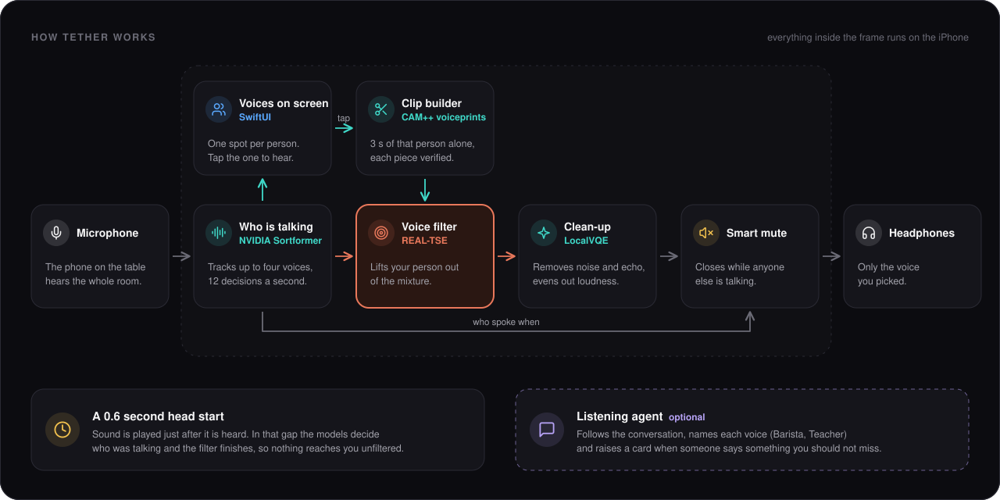

<p align="center">
  
</p>

<h1 align="center">Tether</h1>

<p align="center">
  <strong>Pick one voice in a noisy room and hear only that person.</strong><br>
  Real-time voice isolation that runs entirely on an iPhone.
</p>

<p align="center">
  
  
  
  
  
  
  
</p>

<p align="center">
  <a href="#how-it-works">How it works</a> ·
  <a href="#features">Features</a> ·
  <a href="#tech-stack">Tech stack</a> ·
  <a href="#getting-started">Getting started</a> ·
  <a href="docs/ARCHITECTURE.md">Architecture</a>
</p>

<p align="center">
  
</p>

## About

A loud room is tiring when you only want to hear one person. For someone who gets overloaded by sound, it can be the difference between staying and leaving.

Tether changes what reaches your ears. Put the phone on the table and your headphones in. The app finds the people talking around you and gives each one a spot on screen. Tap a voice, and that person is all you hear: everyone else, the room's echo and the background noise fade out.

There is no setup, no voice sample to record first, and no cloud. Every model runs on the phone.

**Made for**

| | |
|---|---|
| **Sensory overload** | Keep the room quiet and let one trusted voice through. |
| **Classrooms** | Follow the teacher over a restless room. |
| **Cafés and counters** | Hear the barista, not the grinder and the queue. |
| **Loud tables** | Stay with the one friend you are talking to. |

## How it works

Four models share one phone, and sound is played 0.6 seconds after it is heard. That short head start is the trick: by the time a moment of sound reaches you, the phone has already worked out who was talking and pulled your person out of it.

1. **Find the voices.** A streaming speaker model on the Neural Engine decides who is talking 12 times a second: a quick guess first, a confident answer half a second later.
2. **Learn the one you tap.** The app gathers three seconds of that person talking alone, and voiceprints every piece so a wrong voice cannot get in.
3. **Lift them out.** A target-speaker extraction model uses that clip to pull the matching voice out of the mixture, 40 milliseconds at a time, even while others talk over them.
4. **Polish.** Noise and echo are removed, the voice is brightened, and loudness is evened out so a distant speaker is as easy to hear as a near one.
5. **Mute the rest.** When someone else is clearly talking, the gate closes. It reopens just before your person starts, so first syllables are not clipped.

The layer-by-layer breakdown, with measurements, is in **[docs/ARCHITECTURE.md](docs/ARCHITECTURE.md)**.

## Features

| | |
|---|---|
| **Automatic voice discovery** | Each person appears on screen a couple of seconds after they start talking. |
| **One-tap isolation** | Tap a voice to hear that person; tap again to let go. |
| **Works through overlap** | The voice filter keeps your person audible while others talk over them. |
| **Noise and echo removal** | A dedicated clean-up model runs on everything you hear. |
| **Automatic loudness** | Quiet and distant voices are raised to a comfortable level. |
| **Listening agent** | Optional. Follows the conversation, names each voice from what they say ("Barista", "Teacher") and raises a card when something is said that you should not miss. |
| **Clear voice states** | Voices change colour as the app learns them: learning, ready to pick, on. |
| **Guided first run** | A short walkthrough explains the screen. |
| **Built-in measurement** | Every session writes a log and a recording to the phone, with tools to analyse them. |

## Performance

Measured from the app's own session logs on an iPhone 13 Pro.

| Metric | Result |
|---|---|
| Voice filter and clean-up | **25 ms** per 40 ms of sound (faster than real time) |
| Who-is-talking updates | **12 per second** |
| Other speakers muted while talking alone | **94%** of the time |
| Models running together on the phone | **4** |
| Audio sent to a server for isolation | **None** |

## Tech stack

| Layer | Technology |
|---|---|
| App and interface |    |
| Real-time audio |   |
| Who is talking |   via [FluidAudio](https://github.com/FluidInference/FluidAudio) |
| Voice filter |   |
| Voiceprints |   |
| Noise and echo removal |   |
| Analysis tools |  |
| Build |   |

## Getting started

**Requirements:** a Mac with Xcode, [XcodeGen](https://github.com/yonaskolb/XcodeGen) (`brew install xcodegen`), and an iPhone on iOS 17 or later with headphones.

```sh
git clone --recurse-submodules https://github.com/aleburrascano/tether
cd tether
./scripts/fetch_deps.sh
```

Copy the voice filter's two model files, `enroll.onnx` and `chunk_int8.onnx`, into `ios/HearProbe/Models/`. They are not stored in git.

```sh
cd ios
DEVELOPMENT_TEAM=<your Apple team id> xcodegen generate
open HearProbe.xcodeproj
```

Select your phone, press Run, and put your headphones in. The first launch downloads the on-device models (about 290 MB).

The listening agent is optional. It runs as a small service on a Mac on the same network; set its address in `ios/HearProbe/Agent.swift`. Without it, the app works the same and voices are numbered.

## Project structure

```
ios/HearProbe/     the app
  Audio.swift        microphone in, delay line, mute gate, headphones out
  Voices.swift       who is talking, and the mute decisions
  Extractor.swift    clip builder, voice filter, clean-up
  Agent.swift        listening agent client
  ContentView.swift  main screen, walkthrough, settings
docs/              architecture notes and the diagram
tools/             session reports, mute replay, voiceprint calibration
scripts/           dependency setup
```

## Roadmap

- **Larger, more reverberant rooms**, by training the voice filter on far-field speech.
- **More than four voices**, and separating people who sound alike.
- **An on-device listening agent**, so nothing leaves the phone at all.
- **Shadow mode**: stay in silence until a trusted person says your name, then let only their voice through.

## Privacy

Tether listens to the room it is in. Recordings and logs stay on your phone and are never part of this repository.

## Acknowledgements

Tether builds on [FluidAudio](https://github.com/FluidInference/FluidAudio), NVIDIA's Sortformer speaker model, the REAL-TSE target-speaker extraction baseline, [ONNX Runtime](https://onnxruntime.ai), and [Lucide](https://lucide.dev) icons in the diagram.

<p align="center"><sub>Built at a hackathon, November 2026.</sub></p>
