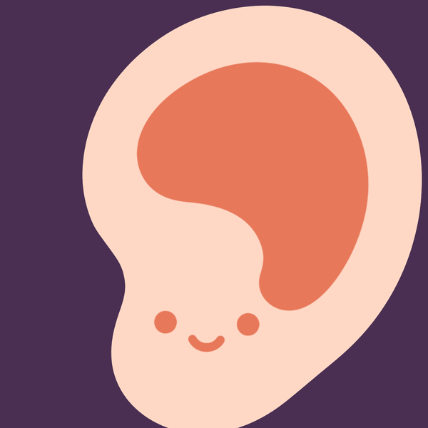
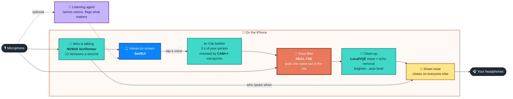

<p align="center">
  
</p>

<h1 align="center">Tether</h1>

<p align="center"><b>Pick one voice in a noisy room and hear only that person.</b></p>

<p align="center">
  
  
  
  
  
  
  
</p>

---

## 🎧 The idea

A loud room is exhausting when you only want to hear one person. For people with sensory overload it can be the difference between staying and leaving.

Tether is the fix: **phone on the table, headphones in.** The app finds the people talking around you and puts each of them on screen. Tap a voice, and that person is all you hear. Everyone else, the echo and the background noise fade away.

No setup. No recording a voice sample first. No cloud. Every model runs on the iPhone in your hand.

**Who it is for**

| | |
|---|---|
| 🧠 **Sensory overload** | Keep the room quiet and let one trusted voice through |
| 🎓 **Classrooms** | A student follows the teacher over a restless room |
| ☕ **Cafés and counters** | Hear the barista, not the grinder and the queue |
| 🍽️ **Loud tables** | Follow the one friend you are talking to |

## ✨ What it does

- 🗣️ **Finds every voice.** Each person gets a spot on screen a couple of seconds after they start talking.
- 👆 **One tap to isolate.** Pick a voice and hear that person, even while others talk over them.
- 🧹 **Cleans the sound.** Noise and room echo are removed, quiet voices are raised, and speech is brightened.
- 🏷️ **Knows who is who.** A listening agent names the voices from what they say ("Barista", "Teacher") and taps you on the shoulder when someone says something you should not miss.
- 🚦 **Shows you when it is ready.** Voices change colour as the app learns them: learning, ready to pick, on.
- 👋 **Welcomes you in.** A first-run walkthrough explains the screen in a few taps.
- 📊 **Measures itself.** Every session is logged, so each layer can be checked and tuned from real use.

## 🏗️ How it works

Four models and a 0.6 second head start. Sound reaches your ears just after the microphone hears it, and in that gap the phone works out who is talking and pulls your person out of the mix.



**Step by step**

1. 🧠 **Find the voices.** A streaming speaker model on the Neural Engine decides who is talking 12 times a second, with a quick guess first and a confident answer half a second later.
2. ✂️ **Learn the one you tap.** The app gathers three seconds of that person talking alone. Every piece is voiceprinted so the wrong voice cannot sneak in.
3. 🎯 **Pull them out.** A target-speaker extraction model takes that clip and lifts the matching voice out of the mixture, 40 milliseconds at a time.
4. 🧹 **Polish it.** Noise and echo removal, a brightness lift, and automatic loudness so a far-away voice is as easy to hear as a near one.
5. 🚪 **Mute the rest.** When someone else is clearly talking, the gate closes. It opens just before your person starts, so first syllables are not clipped.

Want the full picture, layer by layer? → **[docs/ARCHITECTURE.md](docs/ARCHITECTURE.md)**

## 📈 By the numbers

Measured from the app's own session logs on an iPhone 13 Pro.

| | |
|---|---|
| ⚡ **25 ms** | to filter and clean every 40 ms of sound: faster than real time |
| 🔇 **94%** | of the time someone else talked alone, they were muted |
| 🧠 **12×/s** | who-is-talking decisions |
| 🧩 **4 models** | running together on one phone |
| ☁️ **0** | audio sent to a server for the core experience |

## 🧰 Built with

| | Technology | Used for |
|---|---|---|
| 🍎 | **Swift + SwiftUI** | The whole app and its interface |
| 🔊 | **AVAudioEngine** | Low-latency microphone in, headphones out |
| 🧠 | **Core ML on the Neural Engine** | Running the speaker, voiceprint and clean-up models |
| 🟢 | **NVIDIA Sortformer** via [FluidAudio](https://github.com/FluidInference/FluidAudio) | Who is talking, live |
| 🎯 | **REAL-TSE** on **ONNX Runtime** | Extracting one voice from the mix |
| 🪪 | **CAM++** | Voiceprints |
| 🧹 | **LocalVQE** | Noise and echo removal |
| 🎨 | **SceneKit** | The live brain illustration on the main screen |
| 🐍 | **Python** | Session reports and replay tools |

## 🚀 Run it

You need a Mac with Xcode, [XcodeGen](https://github.com/yonaskolb/XcodeGen) (`brew install xcodegen`) and an iPhone on iOS 17 or later.

```sh
git clone --recurse-submodules https://github.com/aleburrascano/tether
cd tether && ./scripts/fetch_deps.sh

# the voice filter's two model files are not in git: copy them in
#   enroll.onnx, chunk_int8.onnx  ->  ios/HearProbe/Models/

cd ios && DEVELOPMENT_TEAM=<your Apple team id> xcodegen generate
open HearProbe.xcodeproj
```

Pick your phone, press Run, put your headphones in. The first launch downloads the on-device models (about 290 MB), then you are listening.

The listening agent is optional: it runs as a small service on a Mac on the same network, set in `Agent.swift`. Without it the app works the same and voices are numbered.

## 🔭 What's next

- 🏛️ **Bigger, echoier rooms**: training the voice filter on far-field speech.
- 👥 **More than four voices**, and telling apart people who sound alike.
- 📱 **The listening agent on the phone**, so nothing leaves the device at all.
- 🫶 **Shadow mode**: stay in silence until a trusted person says your name, then let only their voice through.

## 🔒 Privacy

Tether listens to the room it is in. Recordings and logs stay on your phone and are never part of this repository.

---

<p align="center">Built at a hackathon, November 2026.</p>
