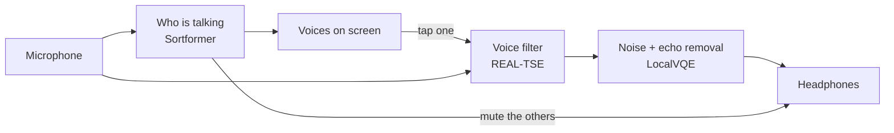

# Tether

**Pick one voice in a noisy room and hear only that person.**

Phone on the table, headphones in. Tether shows who is talking around you. Tap a voice and that person is all you hear: everyone else, the echo and the background noise are turned down. No setup, no voice samples, and all of the listening and filtering runs on the iPhone.

Built for people who get overloaded in noisy rooms, and for anyone who needs to follow one speaker: a student and a teacher, a customer and a barista, one friend at a loud table.

## How it works



1. **Find the voices.** A speaker model on the phone's neural chip works out who is talking, 12 times a second.
2. **Learn the one you tap.** The app collects three seconds of that person talking alone.
3. **Pull them out.** A voice filter extracts that one voice from the mix, even while others talk over them.
4. **Clean it up.** Noise and echo are removed, quiet voices are raised, and everyone else is muted.

Sound reaches your ears 0.6 seconds after the microphone hears it. That gap is what lets the models decide who was talking before you hear it.

An optional listening agent on a nearby Mac names the voices ("Barista", "Teacher") and raises a card when someone says something you would not want to miss.

Details, measurements and limits: [docs/ARCHITECTURE.md](docs/ARCHITECTURE.md).

## Built with

Swift and SwiftUI · [FluidAudio](https://github.com/FluidInference/FluidAudio) (NVIDIA Sortformer, CAM++ voiceprints, LocalVQE) on the Neural Engine · REAL-TSE voice extraction on ONNX Runtime · tested on iPhone 13 Pro and 14 Pro Max with AirPods.

## Run it

Needs a Mac with Xcode, `brew install xcodegen`, and an iPhone on iOS 17 or later.

```sh
git clone --recurse-submodules https://github.com/aleburrascano/tether
cd tether && ./scripts/fetch_deps.sh
# copy enroll.onnx and chunk_int8.onnx (the voice filter, not in git) into ios/HearProbe/Models/
cd ios && DEVELOPMENT_TEAM=<your Apple team id> xcodegen generate
open HearProbe.xcodeproj
```

The first launch downloads about 290 MB of models. The listening agent needs its Mac-side service, which is not in this repository; without it the app works and voices are numbered.

## Honest limits

Echoey rooms and distant or quiet speakers are still hard, it follows four voices at most, and two people who sound alike can share one spot. The brain picture on screen is an illustration that reacts to sound level, not a measurement.

Tether records the room it is in. Recordings and logs stay on the phone and are never committed here.
