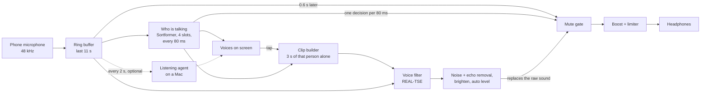

# How Tether works

The short version is in the [README](../README.md). This page is the detail: the two paths sound takes, each layer, the models, what was measured and what does not work yet.

Sound takes two paths through the app. The **audio path** is short and never waits for a model. The **model path** runs beside it and tells the audio path what to play.



The 0.6 s delay between microphone and headphones is what makes this work: by the time a moment of sound is played, the models have already decided who was talking in it and the filter has already cleaned it.

### The layers

| # | Layer | What it does | Where |
|---|---|---|---|
| 1 | **Audio in/out** | Microphone into a ring buffer, played back 0.6 s later through a gate, a boost and a soft limiter. Refuses to play through the phone's own speaker (it would feed back). | `Audio.swift` |
| 2 | **Who is talking** | NVIDIA Sortformer streaming speaker model on the Neural Engine. Four speaker slots, one answer per 80 ms, a quick guess first and a confident answer about half a second later. | `Voices.swift` |
| 3 | **Clip builder** | When you tap a voice, collects about 3 s of that person talking alone. Each piece is checked with a voiceprint so a wrong voice does not get into the clip. | `Extractor.swift` |
| 4 | **Voice filter** | REAL-TSE target-speaker extraction: given the clip, it pulls that one voice out of the mixture, 40 ms at a time. This is what lets you hear someone while another person talks over them. | `Extractor.swift`, `TSE.mm` |
| 5 | **Clean-up** | LocalVQE noise and echo removal on the filtered voice, a brightening shelf above 2 kHz, and automatic loudness per person. | `Extractor.swift`, `Tuning.swift` |
| 6 | **Mute** | Closes when someone else is clearly talking alone, with smoothing so first syllables are not clipped and short gaps do not chop the voice. | `Voices.swift` |
| 7 | **Listening agent** (optional) | Sends the last two seconds of sound, with who was talking, to a Mac on the same network. The Mac keeps a transcript and asks an AI model who each voice is and whether anything needs your attention. | `Agent.swift` |
| 8 | **Screen** | Voices to tap, coloured by state (learning, ready, on), a level display, a first-run walkthrough, and a settings sheet with every switch and live numbers. | `ContentView.swift`, `Brain.swift` |

There is also an experimental **voiceprint layer** (`People.swift`) that keeps its own list of people on top of the speaker model's slots, to recognise someone who reappears in a different slot. It is off by default: in echoey rooms a person scores too low against their own voiceprint for it to be trusted yet.

### Models

| Model | Job | Runs on | Size |
|---|---|---|---|
| Sortformer v2.1 (NVIDIA, via [FluidAudio](https://github.com/FluidInference/FluidAudio)) | who is talking | Neural Engine | ~245 MB, downloaded on first launch |
| REAL-TSE, causal, int8 | voice filter | CPU, ONNX Runtime | 78 MB, not in this repo |
| CAM++ (via FluidAudio) | voiceprints | Neural Engine | ~28 MB, downloaded |
| LocalVQE (via FluidAudio) | noise and echo removal | Neural Engine | ~18 MB, downloaded |

### Measured on an iPhone 13 Pro

From the app's own session logs, small samples:

- The voice filter takes about 25 ms for every 40 ms of sound, noise removal included.
- The speaker model takes about 92 ms per update and runs about 0.34 s behind the microphone.
- With one voice selected, that person was kept at full level while other people talking alone were cut by about 66 dB.

## What it cannot do yet

- **Echoey rooms and distance are hard.** The filter was trained on close, dry speech. Across a reverberant room it mostly lowers the volume.
- **A quieter target loses.** If your person is much quieter than the one interrupting, the filter often follows the louder voice.
- **Four voices at most**, and two people who sound alike can end up sharing one spot.
- **About 0.6 s of delay**, plus Bluetooth. Fine for listening, noticeable if you watch lips.
- **The listening agent is not on the phone.** It needs a Mac on the same network, sends microphone sound to it over plain HTTP, and the Mac-side service (`agent_service.py`) is not in this repository. Without it the app works; voices are just numbered.
- **The brain picture is an illustration.** It reacts to sound level. It does not measure or model anyone's brain.

## Measuring a session

Every run writes `debug_<time>.jsonl` (one line per 80 ms: who the model heard, microphone level, filter in and out level, mute) and a 16 kHz recording to the app's Documents folder. Copy them off the phone with:

```sh
xcrun devicectl device copy from --device <device id> --domain-type appDataContainer \
  --domain-identifier <bundle id> --source Documents --destination phone_logs
```

- `tools/report.py <debug.jsonl>`: per person, how loud and how long; for the selected voice, how much is kept, how much of others leaks, how often the mute cut in.
- `tools/gate_sim.py <logs...>`: replay logged sessions through different mute rules.
- `tools/vpcal`: Swift command-line tool for voiceprint calibration on the Mac.

The flag button in the app saves the last 10 seconds, in and out, when something sounds wrong.
